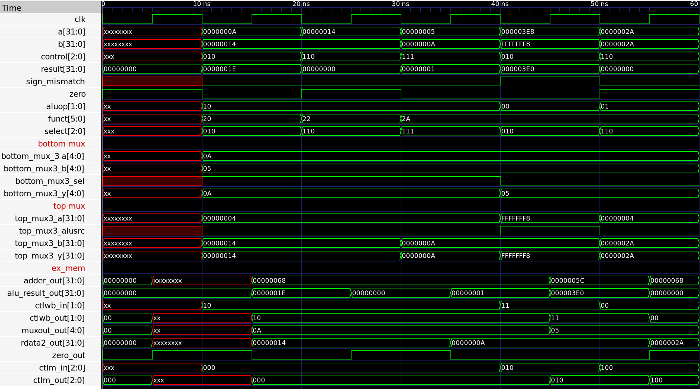

# Coding Assignment 3 — Execute (EX) Stage

ECE 4300, Fall 2026, Cal Poly Pomona.

Complete the Instruction Execute (EX) stage of the MIPS pipeline. The Execute stage receives the outputs of the Decode stage, performs the required arithmetic or logical operation, calculates the branch target, selects the destination register, and passes the results through the EX/MEM latch.

> **Important naming requirement:** Module and testbench names must match `Execute_Testbench.v`. In particular, the top-level Execute module must be instantiated using the exact module and port names expected by the testbench.

## Design Scope and Assumptions

- **In scope:** The MIPS EX stage, including the adder, 5-bit destination-register multiplexer, ALU control, ALU, 32-bit ALU-source multiplexer, and EX/MEM latch.
- **Out of scope:** The Fetch, Decode, Memory, and Write-Back stages. Their outputs are supplied as inputs to the Execute-stage testbench.
- **Assumptions:**
  - The design uses 32-bit data paths for the NPC, register data, sign-extended immediate, branch target, and ALU result.
  - Register destination selection uses a 5-bit multiplexer controlled by `RegDst`.
  - The ALU-source multiplexer selects either `ReadData2` or the sign-extended immediate using `ALUSrc`.
  - The ALU supports addition, subtraction, AND, OR, and set-on-less-than.
  - The EX/MEM latch forwards the Execute-stage outputs to the next pipeline stage.
- **Limitations:**
  - The current `ex_mem` implementation uses a behavioral update delay rather than an edge-triggered clocked latch.
  - Invalid ALU-control combinations produce an unknown (`X`) ALU result.

## Requirements

| Requirement | Description | Verification Method |
|---|---|---|
| REQ-01 | The Execute stage shall calculate the branch target by adding the NPC and sign-extended immediate. | Inspection of `adder.v`; Execute-stage simulation |
| REQ-02 | The 5-bit multiplexer shall select `Instr[15:11]` for R-type instructions or `Instr[20:16]` for I-type instructions. | `RegDst` test in `Execute_Testbench.v` |
| REQ-03 | The ALU-control unit shall convert `ALUOp` and the function field into a 3-bit ALU control signal. | ALU-control testbench |
| REQ-04 | The ALU-source multiplexer shall select register data or the sign-extended immediate based on `ALUSrc`. | `ALUSrc` test in `Execute_Testbench.v` |
| REQ-05 | The ALU shall perform addition, subtraction, AND, OR, and set-on-less-than operations. | ALU testbench |
| REQ-06 | The ALU shall assert `zero` when its result is equal to zero. | ALU waveform and branch test |
| REQ-07 | The EX/MEM latch shall forward the WB, memory, branch, ALU, and destination-register outputs. | Inspection of `ex_mem.v`; Execute-stage waveform |
| REQ-08 | The top-level module and its ports shall use the naming required by `Execute_Testbench.v`. | Compilation and simulation of `Execute_Testbench.v` |

## Architecture

The Execute stage combines the following components:

1. **Adder:** Adds `npcout` and `s_extendout` to produce the branch target.
2. **Bottom multiplexer:** Selects the destination register from `instrout_1511` or `instrout_2016`.
3. **ALU-control unit:** Uses `aluop` and `s_extendout[5:0]` to produce the ALU control signal.
4. **Top multiplexer:** Selects the second ALU operand from `rdata2` or `s_extendout`.
5. **ALU:** Performs the selected arithmetic or logical operation and produces `aluout` and `zero`.
6. **EX/MEM latch:** Passes the Execute-stage results to the Memory and Fetch portions of the pipeline.


### Data-Path Connections

| Input or signal | Destination | Purpose |
|---|---|---|
| `npcout` | `adder` | First input for the branch-target calculation |
| `s_extendout` | `adder`, top mux, ALU-control | Branch offset, immediate ALU operand, and function field source |
| `instrout_2016` | Bottom mux | I-type destination-register candidate |
| `instrout_1511` | Bottom mux | R-type destination-register candidate |
| `rdata1` | ALU | First ALU operand |
| `rdata2` | Top mux and EX/MEM latch | Register-based ALU operand and store-data path |
| `aluop` | ALU-control | Selects the instruction category |
| `regdst` | Bottom mux | Selects the destination register |
| `alusrc` | Top mux | Selects the second ALU operand |

## ALU-Control Operation

The ALU-control module bridges the instruction type and function field with the operation performed by the ALU.

| Instruction operation | `ALUOp` | Function field | ALU action | Control |
|---|---:|---:|---|---:|
| Load word (`LW`) | `00` | `XXXXXX` | Add | `010` |
| Store word (`SW`) | `00` | `XXXXXX` | Add | `010` |
| Branch equal (`BEQ`) | `01` | `XXXXXX` | Subtract | `110` |
| R-type add | `10` | `100000` | Add | `010` |
| R-type subtract | `10` | `100010` | Subtract | `110` |
| R-type AND | `10` | `100100` | AND | `000` |
| R-type OR | `10` | `100101` | OR | `001` |
| R-type set-on-less-than | `10` | `101010` | Set on less than | `111` |


## Control and Output Signals

| Signal | Width | Description |
|---|---:|---|
| `wb_ctl` / `wb_ctlout` | 2 | Write-back control signals passed through the EX/MEM latch |
| `m_ctl` | 3 | Branch, memory-read, and memory-write control signals |
| `branch` | 1 | Branch control output |
| `memread` | 1 | Memory-read control output |
| `memwrite` | 1 | Memory-write control output |
| `EX_MEM_NPC` | 32 | Calculated branch target |
| `zero` | 1 | Indicates that the ALU result is zero |
| `alu_result` | 32 | Result of the ALU operation |
| `rdata2out` | 32 | Register data forwarded to the memory stage |
| `five_bit_muxout` | 5 | Selected destination-register number |

## Implementation

### Source Code

| File | Description |
|---|---|
| `EXECUTE.v` | Top-level Execute stage; connects the adder, multiplexers, ALU-control unit, ALU, and EX/MEM latch |
| `ex_mem.v` | EX/MEM pipeline latch that forwards Execute-stage outputs |
| `alu_control.v` | Converts `ALUOp` and the function field into the 3-bit ALU control signal |
| `alu.v` | Performs arithmetic, logical, and set-on-less-than operations |
| `bottom_mux.v` | 5-bit destination-register multiplexer controlled by `regdst` |
| `top_mux.v` | 32-bit ALU-source multiplexer controlled by `alusrc` |
| `adder.v` | Adds two 32-bit values to calculate the branch target |
| `Execute_Testbench.v` | Top-level testbench used to verify Execute-stage connections and outputs |
| `alu_control_test.v` | Tests the ALU-control truth table |
| `alu_test.v` | Tests the ALU operations and zero output |

### Naming Notes

The Execute-stage source files must use the same names and port connections referenced by `Execute_Testbench.v`. If the testbench instantiates `execute`, use `module execute`; if it instantiates `EXECUTE`, use `module EXECUTE`. Verilog module names are case-sensitive, so the capitalization must match exactly.

Before running the testbench, verify that:

- The top-level module name matches the testbench instantiation.
- Every port name matches exactly, including capitalization and underscores.
- The testbench is compiled together with all Execute-stage source files.
- The testbench uses the same signal widths as the top-level module.

## Testbench Verification

### ALU-Control Testbench

The ALU-control testbench checks the following cases:

- Load/store instructions produce add control `010`.
- Branch instructions produce subtract control `110`.
- R-type function codes produce add, subtract, AND, OR, and set-on-less-than controls.

### ALU Testbench

The ALU testbench changes the control input and checks the resulting operation, including the `zero` output. The tested operations include invalid control input, addition, set-on-less-than, subtraction, OR, and AND.

### Execute Testbench

`Execute_Testbench.v` first tests an R-type configuration and then changes the control signals to test a different source operand and destination-register selection. The main inputs include:

```verilog
ctlwb_in, ctlm_in, npc, rdata1, rdata2, s_extend,
instr_2016, instr_1511, alu_op, funct, alusrc, regdst
```

The testbench should verify the following behavior:

| Test condition | Expected behavior |
|---|---|
| `alusrc = 1` | ALU uses the sign-extended immediate as its second operand |
| `alusrc = 0` | ALU uses `rdata2` as its second operand |
| `regdst = 1` | Destination register comes from `instr_1511` |
| `regdst = 0` | Destination register comes from `instr_2016` |
| `alu_op = 2'b10` and `funct = 6'b100000` | ALU performs addition |
| `alu_op = 2'b01` | ALU-control selects subtraction for branch comparison |

## Timing Diagram



The timing diagram should show the relevant input controls and the corresponding `EX_MEM_NPC`, `zero`, `alu_result`, `rdata2out`, `five_bit_muxout`, and control outputs.

## Compilation and Simulation

Compile the Execute-stage source files and the testbench together. For example, with a Verilog simulator:

```bash
iverilog -g2012 -o execute_sim \
  EXECUTE.v ex_mem.v alu_control.v alu.v \
  bottom_mux.v top_mux.v adder.v Execute_Testbench.v
vvp execute_sim
```

The exact filenames may be adjusted to match the repository, but the top-level module and testbench names must remain consistent.

## Conclusion

This assignment implements the MIPS Execute stage as a collection of connected combinational modules followed by the EX/MEM pipeline latch. The design calculates branch targets, selects ALU operands and destination registers, performs the required ALU operation, generates the zero flag, and forwards all required signals to the next stage of the pipeline.
